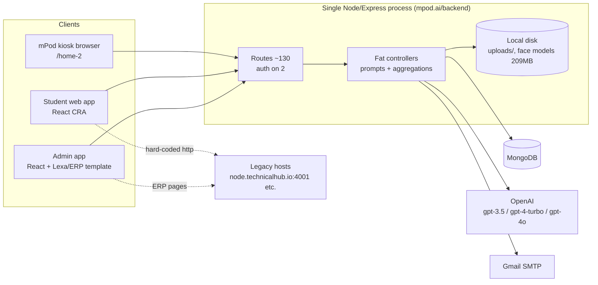
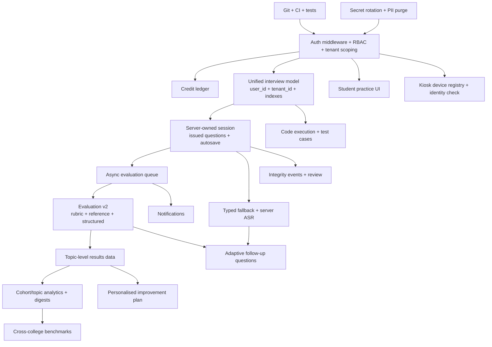
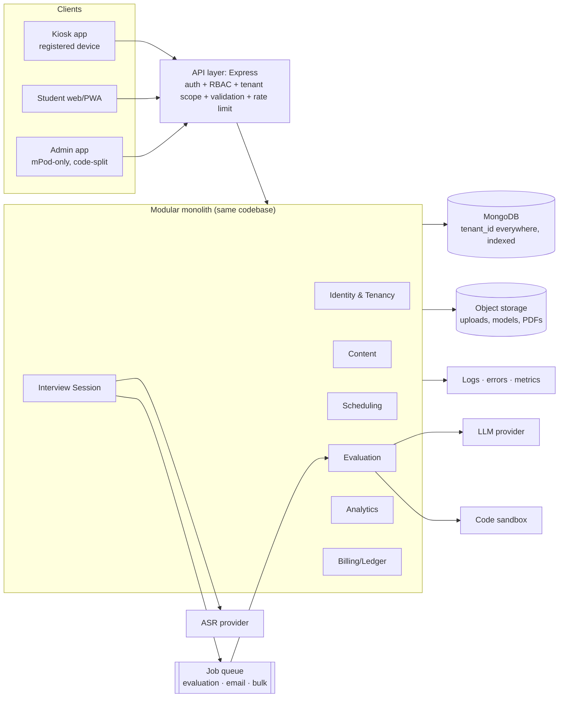

# mPod — Project Intelligence, Feature Discovery & Future Scope

> **Scope of evidence:** full read of `backend/` (Express + MongoDB, ~9.9k LOC), structured review of `frontend/` (student React app, ~17k LOC) and `Admin/` (React admin, ~144k LOC, of which roughly 15k LOC is mPod-specific). There is no git history, no README content beyond CRA boilerplate, no product docs and no tests, so **everything below is inferred from code, configuration and assets**. Where evidence is missing, the text says *Insufficient evidence*.
>
> **Legend for status:** Fully Implemented · Partially Implemented · Prototype · Placeholder · Planned · Broken · Deprecated/Dead · Unknown.
>
> **Analysis date:** 2026-10-06. Code references are `path:line`.

---

## 1. Executive Summary

**mPod is a multi-tenant AI mock-interview platform for engineering colleges.** It was built by Technical Hub and is deployed at `mpod.ai`. A college (the *tenant*) buys interview **credits**. Its admins schedule timed interviews for students by roll number. Students take them in one of two places:

- on a physical **"mPod" kiosk/booth on campus** (`platform: "mpod"`, entered with only a roll number at `/home-2`), or
- in their own browser (`platform: "web"`).

There are three interview types:

1. **Technology interviews.** The AI generates questions from a technology → module → topic syllabus. The questions are read aloud, and students answer by voice.
2. **Company interviews.** Questions are drawn from a bank of company-specific past questions.
3. **Coding interviews.** The student works through three steps: idea → code → optimisation.

OpenAI models score each answer, generate an overall strengths/weaknesses analysis, and the student gets a report (with PDF download). Admins see usage dashboards per tenant and platform-wide.

**Current state in one line:** the core loop (schedule → attend → AI-evaluate → report) works end-to-end, but it rests on an **almost entirely unauthenticated API**. Its security flaws allow **account takeover with no credentials**. The code also contains data-integrity bugs in submission and credit accounting, and **a large amount of dead template/ERP code** in both front-ends.

### Top findings

| # | Finding | Severity |
|---|---|---|
| 1 | `GET /backend/api/find-session-token/:roll_no` returns the live session JWT of any user, admins included, with no auth (`backend/src/controllers/UserController.js` `findSessionToken`). Knowing a roll number is enough to take over the account. | **CRITICAL** |
| 2 | `GET /backend/api/get-users/:tenantId` returns full user documents (bcrypt hash, OTP, sessionToken, PII) with no auth. `GET /get-tenants` (also open) supplies the tenant IDs. | **CRITICAL** |
| 3 | Only 2 of ~130 routes use auth middleware. Tenants, credits, users, interviews and question banks can all be created, edited or deleted anonymously. `admin-login` does not check role, so any student credential yields an admin session. | **CRITICAL** |
| 4 | OTP reset: 6 digits, no expiry, no attempt limit, `check-otp` acts as an oracle, and the OTP is printed to the server log. It can be brute-forced. | **CRITICAL** |
| 5 | Secrets and PII in the working tree: `.env` files with OpenAI, Mongo, SMTP, S3 and JDoodle secrets; a Firebase **service-account private key** (`backend/src/config/technical-hub-16c0e-…json`); ~3,500 retained student Excel uploads (`backend/uploads/`); student photos in `frontend/public/`. | **CRITICAL** |
| 6 | At the end of tech/company interviews the client POSTs every answer to a **hard-coded `http://node.technicalhub.io:4001/api/get-accuracy/`** and calls `handleSubmit()` once per question (`frontend/src/components/rules-details/interview/index.jsx:120-131`). Each submission therefore triggers N duplicate submits and N×(N+1) LLM calls. | HIGH |
| 7 | The client owns the interview content: it receives generated questions and posts back `{question, answer}` pairs, which the server scores as given. Nothing stops a student from substituting easy questions. | HIGH |
| 8 | Credits are not a ledger. The non-atomic `active_credits -= 1` can go negative. `update-tenant` resets `active_credits` to the sum of top-ups and erases consumption. Deleting an interview refunds the credit even after it was attempted. | HIGH |
| 9 | Proctoring and emotion capture are inconsistent. The code is commented out for tech/company interviews and active only for coding interviews. Results are never persisted as violations. `submit-emotions` is broken and `get-emotions` never responds. | MEDIUM |
| 10 | Both front-ends are built on purchased templates (an NFT marketplace for students; Lexa/Technical-Hub ERP for admin). About 290 admin routes and ~16 student template routes are still publicly routed, and roughly 190 admin endpoints 404 against this backend. A `fakeBackend()` mock with demo credentials runs in production. | MEDIUM |

**Recommendation:** freeze feature work for 4–6 weeks and execute a **"Secure & Own the Session"** foundation milestone, covering authN/authZ, tenant scoping, server-owned interview sessions, a credit ledger, secret rotation, PII purge and dead-code removal. Only after that should the product invest in its natural differentiators: better evaluation (rubrics, code execution, adaptive follow-ups) and placement-cell analytics.

---

## 2. Project Identity

| Attribute | Finding | Evidence |
|---|---|---|
| Name | **mPod** ("mPOD" in OTP email; "AI Interview" page title) | `UserController.sendOtp`, `frontend/public/index.html` |
| Owner/brand | Technical Hub (technicalhub.io); the admin is forked from the "Maya" Technical Hub ERP | CORS list `backend/app.js:44-56`, `Admin/package.json` homepage `maya.technicalhub.io/admin/` |
| Production host | `https://mpod.ai` (frontend, `/admin`, `/backend`) | CORS, `LiteInterviewController.getTechnologiesWithQuestions` baseUrl |
| Core purpose | Give college students realistic, scheduled, AI-evaluated mock interviews (technical, company-specific, coding) and give colleges visibility into readiness | interview models + dashboards |
| Primary problem | Placement-readiness practice does not scale: faculty and trainers cannot run 1:1 mock interviews for thousands of students | inferred from bulk scheduling by roll number, tenant credits |
| Primary users | Final/pre-final year engineering students (roll numbers such as `21A91A05F1`, Indian JNTU format; `en-IN` speech; `Asia/Kolkata` time) | models, STT config |
| Secondary users | College placement cell (`tenantadmin`, `placementadmin`), trainers (`trainer`), Technical Hub content and ops staff (`admin`), platform owner (`superadmin`) | `Admin/src/components/VerticalLayout/SidebarContent.js`, `Dashboard/index.js:39,59` |
| Target organisations | Engineering colleges / universities, and training companies serving them | tenant model (`organization_name`, `organization_code`, credits) |
| Core value proposition | "Every student gets proctored, AI-scored interview practice on a schedule, and the college gets a dashboard of who is ready." | |
| Main workflow | Admin schedules an interview (single or bulk Excel) → student attends in the 5-minute window (kiosk or web) → AI generates/serves questions → student answers (voice/code) → AI scores → report | §10 |
| Expected outcome | Students improve interview performance; colleges improve placement rates and can prove training effort | |

**"If I had never seen this project before, what would I need to know?"**
mPod exists because colleges must prepare thousands of students for campus placements, and human mock interviews do not scale. The product is a **credit-metered, college-administered, AI interview booth**, physical and virtual. Its unit of value is *one evaluated interview*. Its buyers are colleges, not students. Everything else (question banks, syllabus trees, dashboards) serves that unit.

---

## 3. Core Problem

- **Who experiences it:** students who get little realistic interview practice before campus drives, and placement officers (TPOs) who cannot measure readiness at scale.
- **Status quo:** occasional faculty mock interviews, peer practice, generic online question lists, and expensive third-party assessment vendors.
- **Why mPod over manual practice:**
  - It is available on a schedule for an entire batch.
  - It mirrors a real interview (spoken questions, timed answers, camera on).
  - It gives instant per-question feedback.
  - It produces aggregate data for the college.
- **Most important workflow:** **Scheduled interview → AI evaluation → report.** If this loop is wrong (wrong score, lost submission, cheatable), nothing else matters.

## 4. Target Users

| Segment | Description | Needs |
|---|---|---|
| Student (primary) | Engineering undergraduate, India, often on a shared campus kiosk or a low-end laptop/phone | Clear instructions, fair scoring, actionable feedback, retry/practice |
| Tenant admin / placement admin | College TPO / placement cell | Bulk scheduling, cohort readiness, exports, credit visibility |
| Trainer | Faculty/trainer running a batch | Assign interviews, view results of their batch |
| Platform admin (Technical Hub) | Content and ops team | Maintain syllabus and question banks, manage tenants and credits |
| Super admin | Business owner | Cross-tenant usage, daily activity, revenue/credit picture |
| Recruiter / company | *Not a current user* | (Future, see boundary) |

## 5. Core Concept

**A. One line:** mPod is a multi-tenant platform on which colleges schedule AI-run, voice-based, proctored mock interviews for their students and receive scored, explainable reports.

**B. Short:** Colleges buy interview credits and schedule technology, company-specific or coding interviews for students by roll number. At the scheduled time, the student enters a physical mPod booth or the web app. There an AI interviewer reads out questions, listens to spoken answers (or accepts code), and evaluates each answer with an LLM. The student receives a report with accuracy, analysis, improvements and soft-skill parameters. The college sees attendance and performance dashboards.

**C. Detailed:**
- **Problem solved:** scalable, realistic interview practice plus measurement.
- **How:** syllabus-driven question generation (technology → module → topic → level), curated company question banks, a curated coding problem bank, browser speech-to-text and text-to-speech, LLM scoring, and face-api-based attention and emotion signals.
- **Differentiator:** the combination of a **physical campus booth with a college-administered schedule** and AI evaluation. Most competitors are student-self-serve web apps. mPod's B2B2C channel (the college buys, the student uses) and the syllabus mapping to a college's training curriculum are the moat.
- **Most important workflow:** see §3.

**D. Concept boundary**

| mPod **IS** | mPod **IS NOT** |
|---|---|
| A mock-interview & interview-readiness platform | A college ERP (attendance, buses, seating, hall tickets) |
| B2B, college-administered, credit-metered | A general LMS / course platform |
| Evaluation + feedback + readiness analytics | A recruiting ATS or job board |
| Practice for technical, company, coding, HR/behavioural interviews | A competitive-programming judge platform (only as much execution as evaluation needs) |
| Kiosk + web delivery | A video-conferencing tool for live human interviews (maybe later, as an add-on) |

- **Belongs naturally:** question banks, syllabus mapping, AI evaluation quality, proctoring/integrity, student reports and progress, practice mode, cohort analytics, scheduling/notifications, credit/billing, content tooling.
- **Feature creep to resist:** the ERP modules already sitting in the Admin code (attendance, seating, bus, FRS devices, Hoot, certifications, aptitude test engine, ATS resume scoring); blockchain certificates; social features; a full LMS; a job marketplace.

---

## 6. Product Boundary

The Admin application today *physically contains* an entire ERP: Attendance, Batches, Sessions, Placements, Hoot, FRSDevices, SittingAlignment, AptLogic tests, CodingContests, Certifications, ATS, bus management and more. Most of this is routed but hidden from the menu. **Insufficient evidence** that any of it is part of the mPod product. Its endpoints do not exist on the mPod backend, or they call other Technical Hub hosts.

**Decision recommended:** formally declare these **out of scope for mPod** and remove them from the mPod admin build. If Technical Hub needs them, they belong to the separate "Maya" ERP.

---

## 7. Complete Feature Inventory (current state only)

### 7.1 Backend & cross-cutting

| Feature | Module | User | Purpose | Status | Evidence | Dependencies |
|---|---|---|---|---|---|---|
| Student login (roll no + password, JWT in httpOnly cookie, single-session prompt) | Auth | Student | Access | **Partially Implemented** (works; insecure) | `UserController.login`; `frontend/src/pages/Login.jsx` | bcrypt, JWT |
| Admin login | Auth | Admins | Access | **Partially Implemented**: no role check | `UserController.adminLogin:184-228` | |
| Logout | Auth | All | End session | **Partially**: the student app calls the backend; the admin app only clears localStorage | `userRoutes.js` logout; `Admin/src/pages/Authentication/Logout.js:7` | authMiddleware |
| Single active session enforcement | Auth | Student | Prevent sharing | **Broken by design**: the client calls unauthenticated `update-session-token` before every login | `Login.jsx:21,43`; `UserController.updateSessionToken` | |
| Forgot password via email OTP | Auth | Student | Recovery | **Partially Implemented** (works; brute-forceable) | `sendOtp/checkOtp/resetPassword`; `ForgotPassword.jsx` | Gmail SMTP |
| Admin forgot password | Auth | Admin | Recovery | **Placeholder**: template fake-backend saga | `Admin` `REACT_APP_DEFAULTAUTH=fake` | |
| Current user endpoints | Auth | All | Identity | **Fully Implemented** (DB lookup by token) | `getCurrentUser`, `getAdminCurrentUser` | |
| Route authorisation middleware | Security | — | Protect API | **Placeholder**: used on 2 routes; `validateTokenHandler` unused | `middlewares/*`, `userRoutes.js` | |
| Tenant CRUD with credits & interview duration | Tenancy | Platform admin | Onboard colleges | **Fully Implemented** functionally; credit logic flawed | `TenantController.js` | |
| Credit consumption on scheduling, refund on delete | Billing | System | Metering | **Partially Implemented**: non-atomic, can go negative, refunds attempted interviews | `InterviewController.addInterviewDetails`, `deleteInterviewDetails` | |
| Bulk user import (Excel) | Users | Admin | Onboard students | **Partially Implemented**: raw password stored, role from sheet | `UserController.addUser` | xlsx |
| Bulk profile-picture upload (zip by roll no) | Users | Admin | Photos for reports/kiosk | **Fully Implemented** | `uploadProfilePics` | unzipper |
| User list per tenant | Users | Admin | Manage | **Fully Implemented** (leaks secrets) | `getUsers` | |
| User edit/delete | Users | Admin | Manage | **Broken**: the admin calls non-existent endpoints | `Admin/src/pages/Users/EditUser.js:46,75`, `UsersList.js:76` | |
| Technology / Module / Topic syllabus tree CRUD (+ icons, Excel topics) | Content | Platform admin | Drive question generation | **Fully Implemented** (delete hidden in UI) | `Technology/Module/TopicController` | multer |
| Companies & tags CRUD | Content | Platform admin | Company bank taxonomy | **Fully Implemented** | `CompanyController`, `TagController` | |
| Company question bank (by company/round/type/year/tag, Excel upload, export) | Content | Platform admin | Company interviews | **Partially**: admin delete hits `delete-topic` (wrong endpoint) | `CompaniesQuestionsList.js:284` | |
| Coding question bank (problem, complexity, time, I/O, constraints) | Content | Platform admin | Coding interviews | **Partially**: delete broken/commented; no test cases | `CodingQuestionController`, model `codingQuestion.js` | |
| "Lite" interview Q&A bank (question + model answer, company tags, star/"previously asked") with Excel upload | Content | Platform admin | Practice bank | **Fully Implemented** (admin) | `LiteInterviewController.addInterviewQuestions` | |
| Student practice on Q&A bank: favourites, doubts, star questions, lite AI-scored practice | Practice | Student | Self-study | **Partially Implemented**: backend only; **no UI in this repo** | `liteInterviewRoutes.js`; frontend search found none | |
| Technology interview scheduling (single/bulk, overlap check, tenant duration) | Scheduling | Admin/Trainer | Assign | **Fully Implemented** | `addInterviewDetails`, `addBulkInterviewDetails` | |
| Company interview scheduling (multi-company, rounds, types, tag; availability count) | Scheduling | Admin | Assign | **Fully Implemented** | `CompanyInterviewController` | |
| Coding interview scheduling (level, count) | Scheduling | Admin | Assign | **Fully Implemented** | `CodingInterviewController.addInterviewDetails` | |
| Schedule email notification | Notifications | Student | Reminder | **Partially**: sent on bulk/coding; commented out for single tech interview | `InterviewController.js:236-253` vs `:612-640` | Gmail SMTP |
| "Replica" interview add (10-min fixed duration, no email) | Scheduling | Unknown | Unknown (likely kiosk demo/test) | **Unknown** | `addInterviewDetailsReplica` | |
| AI question generation for tech interviews | AI | System | Fresh questions | **Fully Implemented** (gpt-3.5-turbo, `max_tokens: 256` can truncate) | `InterviewController.generateQuestions:1441-1560` | OpenAI |
| Company / coding question sampling | Content | System | Serve questions | **Fully Implemented** (`$sample`) | `generateCompanyQuestions`, `generateCodingQuestions` | |
| Per-answer AI scoring (accuracy, analysis, improvements, confidence) | AI | System | Evaluation | **Fully Implemented**, sequential and injection-prone | `getAccuracy:1129-1266` (gpt-4o) | OpenAI |
| Overall analysis (strengths, improvements, 7 soft-skill %) | AI | System | Summary | **Fully Implemented** (gpt-3.5-turbo) | `getOverallAnalysis:1378` | OpenAI |
| Coding evaluation (is_code, accuracy, complexity, quality, optimisation %) | AI | System | Evaluation | **Prototype**: LLM opinion, no execution; "memory_usage_kb" is fabricated by the LLM | `submitCodingInterview:643-848` (gpt-4-turbo) | OpenAI |
| Idea check gate (≥50% to proceed) | AI | Student | Structured thinking | **Fully Implemented** | `analyzeIdea`; `codingInterview.jsx:264-305` | |
| Open "temporary" scoring endpoint | AI | Unknown | Testing | **Dead / risk**: unauthenticated GPT-4o proxy | `getAccuracyTemporary` | |
| Emotion/attention capture (face-api: emotions, head pose, blinks) | Proctoring | System | Engagement/integrity | **Partially**: active only in coding; commented out in tech/company | `codingInterview.jsx:437-602`; `interview/index.jsx:273-511` | face-api models (209 MB served by backend) |
| Anti-cheat (copy/paste block, devtools heuristic, multi-face alert, screenshots) | Proctoring | System | Integrity | **Prototype**: client alerts only, nothing persisted | `codingInterview.jsx:461-679` | |
| `submit-emotions` / `get-emotions` | Proctoring | System | Store emotions | **Broken** (`$dateFromString` on a Date field) / **Broken** (never responds) | `InterviewController` tail | |
| Student dashboard (upcoming, past, counts, accuracy by type, platform split) | Student | Student | Progress | **Fully Implemented** | `Dashboard.jsx`; `UserController` counts | |
| Interview report (per-question accordion, strengths, PDF) | Reports | Student/Admin | Feedback | **Fully Implemented** (emotion/confidence charts commented out) | `Report.jsx` | react-to-pdf |
| Coding report | Reports | Student/Admin | Feedback | **Fully Implemented** | `CodingReport.jsx` | |
| Kiosk entry by roll number | Kiosk | Student | Booth flow | **Fully Implemented** (no authentication) | `frontend/src/pages/Home2.jsx:25` | |
| Booth camera control (LAN `camera_control.php`) | Kiosk | System | Hardware | **Deprecated** (commented / unused files) | `rules-item3/index-original.jsx:26` | |
| Tenant dashboard (users by gender, assigned vs attempted, platform split, question counts, yesterday stats, chart) | Analytics | Tenant admin | Monitoring | **Fully Implemented** | `Admin/src/pages/Dashboard/stats/*`; `DashboardController` | |
| Super-admin dashboard (overall, tenant-wise, yesterday, current, day-wise chart) | Analytics | Super admin | Business view | **Fully Implemented** (but no superadmin sidebar menu) | `Dashboard/SuperAdmin/*` | |
| Date-range tech-wise kiosk stats | Analytics | Unknown | Reporting | **Partially**: API only, no UI | `getTechnologyWiseMpod…` | |
| Hourly stats | Analytics | — | — | **Dead** (not routed) | `DashboardController.getHourlyInterviewStats` | |
| Interview list filters, pagination, Excel export | Admin | Admin | Operations | **Fully Implemented** | `Admin/src/pages/MayaAI/*` | xlsx |
| Server time endpoint | Infra | Client | Clock sync | **Fully Implemented**, but mounted at `/api/server-time`, outside `/backend` | `app.js` | |
| Background jobs / cron | Infra | — | — | **Placeholder** (empty `src/cron/`, `node-cron` unused) | | |
| WebSocket real-time | Infra | — | — | **Dead** (commented) | `app.js:37` | |
| S3, Google APIs, GitHub (Octokit), gTTS, ffmpeg, Fuse, exceljs, express-validator | Infra | — | — | **Dead dependencies**, never required | `backend/package.json` | |
| JDoodle code execution | Coding | — | — | **Planned/Dead**: env keys only | `backend/.env` key names | |
| i18n (Admin) | UX | — | — | **Dead** (misconfigured `en` vs `eng`) | `Admin/src/i18n.js` | |

### 7.2 Template / ERP code shipped but not part of mPod
- **Student app:** ~16 NFT-marketplace routes (`/explore`, `/liveAuction`, `/connectwallet`, `/createItem`, `/register`, `/blog*`…). These are **Dead**, and `/blog-details` crashes.
- **Admin:** ~180 ERP routes and ~60 template demo routes (UI kit, icons, charts, email, chat, kanban). They are **Dead** (404 against this backend) or **call external Technical Hub hosts** (Notifications, Registrations, AppHeader, TrainerFeedback → `node.technicalhub.io:4001`; ATS → raw IP `34.27.225.19:5003`).

---

## 8. Feature Hierarchy (current)

```
mPod
├── 1. Identity & Access
│   ├── Student login → roll no/password · single-session prompt · logout
│   ├── Admin login → cookie session · (no role check)
│   ├── Password recovery → email OTP (student only)
│   └── Current-user lookup → student / admin+tenant
├── 2. Tenancy & Credits
│   ├── Tenant CRUD → org name/code · contact · status · interview duration
│   └── Credits → top-up list · active balance · consume on schedule · refund on delete
├── 3. User Management
│   ├── Bulk import (Excel) · list by tenant
│   ├── Profile pictures → zip upload · served by roll no
│   └── Edit / delete → (broken)
├── 4. Content Management
│   ├── Syllabus tree → Technology → Module → Topic (icons, Excel topics)
│   ├── Company taxonomy → Companies · Tags
│   ├── Company question bank → company · round · type · year · tag · Excel · export
│   ├── Coding problem bank → complexity · time · I/O · constraints
│   └── Q&A practice bank ("lite") → question · model answer · companies · star · Excel
├── 5. Interview Scheduling
│   ├── Technology interview → tech/modules/topics/level/count · single · bulk Excel
│   ├── Company interview → companies/rounds/types/tag/count · availability check
│   ├── Coding interview → level/count
│   ├── Overlap guard → tenant duration window
│   └── Email notification (partial)
├── 6. Interview Delivery
│   ├── Entry → web dashboard window (start..+5 min) · kiosk roll-no entry
│   ├── Instructions + 15 s auto-start
│   ├── Tech/Company → TTS question · 5 s buffer · STT answer · 60 s/question · auto-advance
│   ├── Coding → Idea (AI gate) → Code (textarea) → Optimise · timer per problem
│   └── Proctoring → face-api emotions/head/blinks · multi/no-face alerts · copy/paste & devtools blocks (coding only)
├── 7. AI Evaluation
│   ├── Question generation (tech)
│   ├── Per-answer scoring (accuracy · analysis · improvements · confidence)
│   ├── Overall analysis (strengths · improvements · 7 parameters)
│   └── Coding evaluation (correctness · complexity · quality · optimisation)
├── 8. Reports
│   ├── Interview report → per-question accordion · accuracy · confidence · PDF
│   └── Coding report → idea · code · optimised · complexity · emotions
├── 9. Student Dashboard
│   └── Upcoming · past (attended/expired) · counts by type · accuracy by type · kiosk vs web
├── 10. Practice (backend only)
│   └── Questions by technology · favourites · doubts · star questions · lite scoring
└── 11. Analytics (Admin)
    ├── Tenant dashboard → users · assigned/attempted · platform · bank sizes · yesterday · chart
    ├── Super-admin dashboard → overall · per-tenant · yesterday · today · day-wise
    └── Interview lists → filters · pagination · Excel export
```

---

## 9. User Roles

| Role | Permissions (as implemented) | Main actions | Main screens | Restrictions (actual) |
|---|---|---|---|---|
| `student` (any non-admin user) | Read own dashboard/reports; attend interviews | Login, attend, view report, reset password | Login, Dashboard, Interview, Report | **None enforced server-side.** The API accepts any `roll_no` in the URL or body. |
| `trainer` | Menu: Interviews | Schedule & view interviews | Admin → Interviews | Menu-only; can open any admin URL |
| `placementadmin` | Menu: Interviews list | View interviews | Admin → Interviews | Menu-only |
| `tenantadmin` | Menu: Dashboard, Users, Interviews | Import users, schedule, monitor | Dashboard, Users, Interviews | Menu-only; tenant ID is client-supplied |
| `admin` (Technical Hub) | Menu: everything mPod | Tenants, content banks, interviews | All mPod pages | Menu-only |
| `superadmin` | Super-admin dashboard | Cross-tenant stats | Dashboard | **No sidebar menu** for this role |

**RBAC gaps:**
1. No server-side role or tenant enforcement anywhere.
2. Roles are free-text strings set by an Excel import, so an import can create admins.
3. `admin-login` accepts any role.
4. There is no permission model; the Permissions page belongs to the ERP and is dead.
5. Trainers are not scoped to batches. **Insufficient evidence** that a batch concept exists in mPod at all.
6. Super-admin vs admin distinction is inconsistent.

---

## 10. User Journeys

### 10.1 Admin schedules a technology interview (bulk)
1. **Entry:** Admin → AI Interviews → Add.
2. **Action:** picks technology → modules → topics, level, count, date-time, platform; uploads a roll-number sheet.
3. **System:** `POST /backend/api/add-bulk-interviewee-details` (multipart).
4. **Controller:** `InterviewController.addBulkInterviewDetails` loads the tenant and checks `active_credits === 0` **once**, then for each row calls `createInterview`, which checks the overlap window across 3 collections, inserts the interview, emails the student and decrements credits.
5. **DB:** `interviews.insert`, `tenants.save` per row.
6. **Result:** HTTP 207 with per-row success/failure.
7. **Errors:** a mid-batch credit overrun is unguarded and the balance goes negative. The email send is awaited inside the loop, so one SMTP failure marks that row failed **after** the interview was saved, without a credit decrement. Large sheets run serially and can time out.

`Admin UI → POST add-bulk-interviewee-details → InterviewController → createInterview×N → Mongo(interviews, tenants) + SMTP → 207 → UI table`

### 10.2 Student attends a technology/company interview (web)
1. **Entry:** Dashboard shows "Attempt" from start time to +5 min (`Dashboard.jsx:270-311`).
2. Instructions page with profile photo; 15 s auto-start.
3. **Questions:** tech → `POST generate-questions` (raw OpenAI response is split on newlines **on the client**); company → `POST generate-company-questions`.
4. **Loop:** TTS reads the question (`voices[5]`) → 5 s buffer → browser STT (`en-IN`) → 60 s → auto-advance.
5. **Submit:** for each answer, POST to the hard-coded `node.technicalhub.io:4001/get-accuracy` **and** call `handleSubmit()` → `POST /backend/api/get-accuracy` with all Q&A.
6. **Server:** `getAccuracy` makes N sequential GPT-4o calls plus 1 GPT-3.5 overall call, then updates the interview (`status:0`, push results) **if still status 1**.
7. **Result:** redirect to `/report?roll_no&id&interview_type`.
8. **Errors:**
   - No STT on Firefox/Safari (dead end).
   - No typing fallback.
   - Mic or network failure loses answers.
   - LLM latency is 15–60 s with no progress feedback.
   - Duplicate submits: the first write wins and later ones are ignored, but LLM cost is multiplied.
   - The rules say a reload expires the interview, but nothing enforces it.
9. **Success:** the report renders the per-question analysis.

```mermaid
sequenceDiagram
  participant S as Student (browser/kiosk)
  participant FE as frontend (React)
  participant BE as backend (Express)
  participant AI as OpenAI
  participant DB as MongoDB
  S->>FE: open Dashboard / kiosk roll no
  FE->>BE: POST get-interviewee-details {roll_no}
  BE->>DB: aggregate interviews in [start, start+5m]
  FE->>BE: POST generate-questions
  BE->>AI: gpt-3.5-turbo (prompt w/ topics)
  BE-->>FE: raw completion (client parses)
  loop each question (60s)
    FE->>S: TTS question, STT answer
  end
  FE->>FE: POST x N to http://node.technicalhub.io:4001 (legacy!)
  FE->>BE: POST get-accuracy {questions, answers} (x N duplicates)
  loop each answer (sequential)
    BE->>AI: gpt-4o score
  end
  BE->>AI: gpt-3.5 overall analysis
  BE->>DB: update interview status 0 + results
  BE-->>FE: results
  FE->>S: /report
```



### 10.3 Student attends a coding interview
`generate-coding-questions` → per problem: Idea → `analyze-idea` (≥50% gate) → Code (textarea, no run) → Optimise → `submit-coding-interview` (GPT-4-turbo ×2 per problem, sequential) → `/coding-report`. Face tracking and anti-cheat are active. The submit is fired inside a React state updater, so it can **double-submit under StrictMode**.

### 10.4 Kiosk (mPod booth)
Booth browser at `/home-2` → student types roll number → `get-interviewee-details` returns any interview scheduled for `platform:"mpod"` in the window → same flow. **There is no identity verification.** Face-api *recognition* models are served, but **insufficient evidence** that face matching happens anywhere.

### 10.5 Password reset
`send-otp` (email) → `check-otp` → `reset-password`. OTPs never expire and attempts are not limited.

### 10.6 Broken or incomplete flows
- Admin user edit/delete.
- Company-question delete (wrong endpoint).
- Coding-question delete.
- Admin forgot password (fake).
- Admin "already logged in" branch calls the student login.
- `submit-emotions`; `get-emotions` hangs.
- Total-topics report (ERP endpoints).
- Super-admin menu.
- Student template pages (`/blog-details` crashes).
- Lite practice has no UI.

---

## 11. System Architecture

### Frontend (student) — `frontend/`
- **Stack:** CRA 5, React 18.2, react-router 6.
- **State:** local `useState` plus `localStorage` (`intervieweeDetails`); no global state.
- **API:** axios. `axiosInstance` (withCredentials, 401 → /login) plus plain axios in places.
- **Interview functionality:** react-speech-recognition (STT), react-speech-kit (TTS), react-webcam + face-api.js 0.22, react-to-pdf, react-circular-progressbar.
- **Template base:** "Nufti" NFT template (`package.json` name `nuftireact`).
- **Gaps:** no route guards, no error boundary, no validation library.
- **Deployment:** an Apache `.htaccess` SPA rewrite (`RewriteBase /subdirectory` placeholder). A `3000-fe-build` dev-server log suggests the dev server may be used in production. *Insufficient evidence* to confirm.

### Frontend (admin) — `Admin/`
- **Stack:** Lexa React template plus the Technical Hub ERP fork; CRA 5, React 18.2, router 6 with basename `/admin`, redux + saga (template state only).
- **Libraries:** reactstrap/bootstrap 5, mdbreact tables (deprecated), and **six chart libraries**.
- **Behaviour:** `fakeBackend()` mock active; route guard = `localStorage.authUser` exists.
- **Bundle:** no code-splitting; ~290 routes in one bundle.

### Backend — `backend/`
- **Stack:** Node, Express 4, Mongoose 7, a single process (`nodemon app.js`).
- **Structure:** routes → controllers (fat controllers holding business logic, aggregation pipelines and prompts). There is no service layer and no validation layer (express-validator installed but unused). Errors are handled by per-handler try/catch, and many handlers return `error.message` to the client. Logging is `console.log` only.
- **Static serving:** face-api models (209 MB) and uploads served from local disk.
- **Integrations:** OpenAI (gpt-3.5-turbo, gpt-4-turbo, gpt-4o, mixed), Gmail SMTP via nodemailer.
- **Declared but unused:** S3, JDoodle, Firebase service account.

### Database — MongoDB

| Collection | Key fields | Relationships | Indexes |
|---|---|---|---|
| users | roll_no, email (unique), password, role, tenant_id, college, branch, passout_year, sessionToken, otp | tenant_id → tenants | roll_no (non-unique), college, branch, passout_year, email unique |
| tenants | organization_name, email, assigned_credits[], active_credits, interview_duration_minutes, organization_code (unique) | — | email, organization_code |
| technologies / modules / topics | name, category, icon | module.technology, topic.module/technology | technology, module |
| companies, tags | name, status | — | — |
| companyquestions | company, type, round, year, tag, question | company, tag | company |
| codingquestions | problem_name, complexity, time, description, input, output, constraints | company (unused) | company |
| liteinterviewquestions | technology, question, answer, company[], previous_asked_status | technology, companies | — |
| interviewquestioninteractions | roll_no, technology, question_id, favorite, doubt | | — |
| interviews / companyinterviews / codinginterviews | platform, roll_no, start_date_time, level / technology+module+topic / company+round+type+tag, questions_count, question_details[], overall_analysis[], emotions, status (1=pending, 0=done) | **linked by roll_no string**, no user_id, no tenant_id | company only |
| liteinterviews | roll_no, technology, … | | — |
| companies_info | rich company profile | | **unused model** |

**Data lifecycle:** interview created with `status 1` → results pushed and `status 0`. "Expired" is computed at read time (empty `question_details` + status 1 + past window). Nothing is archived or retained under a policy. Uploaded Excel files are never deleted.

### Current architecture



---

## 12. Data Flow

`Input (form / voice transcript / Excel) → (no validation) → controller → inline business logic + prompt → Mongo / OpenAI → JSON → UI`

| Concern | Finding |
|---|---|
| Source of truth | Users: `users` collection. Interviews: three separate collections. Tenant membership is derived **through `users.roll_no` joins**, not stored on the interview. |
| Identity key | `roll_no` (string, **not unique**). Two colleges with the same roll number collide in login, reports and stats. |
| Duplicate data | Three near-identical interview schemas and controllers; the scoring prompt is copy-pasted in 4 places (`getAccuracy`, `getAccuracyTemporary`, `getLiteInterviewAccuracy`, the commented legacy version). `college` is a free-text field duplicating tenant. |
| Missing validation | No request schema validation anywhere. Excel rows are inserted as-is (including `role` and `password`). ObjectId casts throw 500s on bad input. |
| Inconsistency risks | Credits (non-atomic, reset on edit, refund on attempted delete); a submit race can partially overwrite; `start_date_time` sometimes treated as a Date and sometimes as a "DD-MM-YYYY HH:mm" string (`submitEmotions`). |
| Security risks | Client controls question text; LLM prompt injection via answers; IDOR on every `:roll_no` / `:id` / `:tenantId` route. |
| Performance | Sequential LLM calls; dashboards `$lookup` users by roll_no on every interview with **no index on `interviews.roll_no`**; full-collection list endpoints with no server pagination; 3 extra `get-admin-current-user` calls per admin navigation. |
| Unnecessary calls | Duplicate submission loop; legacy host call; `find-session-token` + `update-session-token` before every login. |

---

## 13. Admin Capabilities

**Admin (Technical Hub `admin`):**
- Tenants CRUD + credits + interview duration
- Users import / list / profile-pics
- Syllabus tree, companies, tags
- Company, coding and Q&A question banks (Excel upload, export for company questions)
- Schedule all three interview types (single / bulk), edit, delete
- Interview lists with filters, pagination and Excel export; view reports
- Tenant dashboard

**Super admin:** cross-tenant dashboard (overall, per-tenant, yesterday, today, day-wise chart). It has no navigation menu.

**Tenant admin / placement admin / trainer:** dashboard, users, interviews (menu-scoped only).

**Missing:**
- **Controls:** server-side RBAC; credit ledger and history; per-tenant feature flags; question-bank review/approval workflow; prompt/rubric configuration; tenant branding.
- **Moderation:** flag/override AI scores; manual re-evaluation; mark suspicious attempts.
- **Audit:** no audit log of who scheduled, deleted, refunded or edited what.
- **Reporting:** cohort/branch/batch readiness; topic-level weakness heatmaps; student progress over time; scheduled report emails; PDF/CSV exports for TPO presentations.
- **Configuration:** interview templates (presets), per-question timers, retake rules, grace period (hard-coded at 5 min), language/accent, kiosk device registry.

## 14. User (Student) Capabilities

**Available:**
- Login and reset password
- View upcoming interviews (with countdown) and past interviews (attended/expired)
- Attend interviews (web, or kiosk)
- View and download the report
- See counts and accuracy by type

**Missing:**
- Self-practice UI: the backend exists, there is no frontend.
- Retakes / practice interviews without credits.
- Progress over time and topic-level weaknesses.
- Recommendations of what to study next.
- Profile management.
- Typed-answer fallback and accessibility options.
- Notifications in-app or on WhatsApp.
- Results history comparison.
- Mobile-friendly UI.
- Dispute/feedback on a score.
- Consent and privacy controls for camera/emotion data.

---

## 15. Feature Maturity

| Module | Score | Problems | What is required to reach 5 |
|---|---:|---|---|
| Authentication & sessions | **1** | Token disclosure endpoint, unauth session clearing, brute-forceable OTP, no role check, insecure cookie, fake admin auth | Central auth middleware, role and tenant claims, refresh/rotation, hashed OTP with TTL and rate limits, MFA for admins, SSO (Google Workspace/Microsoft) for colleges |
| Authorization / multi-tenancy | **1** | No server checks; tenant from client; roll_no not unique | Policy layer (role × tenant × resource), `tenant_id` on every document, compound unique (tenant_id, roll_no), tests for every route |
| Tenancy & credits | **2** | Non-atomic, resets, refunds after attempt | Append-only credit ledger, atomic `$inc` with guard, invoices/usage export, low-balance alerts |
| Content management | **3** | Broken deletes, no review workflow, no versioning, no test cases for coding | Soft-delete + versioning, bulk-import validation with previews, tagging taxonomy, quality review queue, duplicate detection |
| Scheduling | **3** | Serial bulk, email inside the loop, single-interview email commented out | Job queue, idempotent bulk import with preview, templates, reschedule/cancel flows, calendar invites |
| Interview delivery (voice) | **2** | Duplicate submit, legacy host, Chrome-only STT, no typing fallback, no resume, client-owned questions | Server-owned session state machine, persisted per-answer autosave, cross-browser STT (server ASR), resume after disconnect, accessibility |
| Coding interview | **2** | Textarea, no execution, LLM-guessed complexity/memory | Monaco editor, sandboxed execution against hidden test cases, LLM used only for code-quality commentary |
| AI evaluation engine | **2** | Prompt duplicated, sequential, injection-prone, keyword hack, deprecated models, no rubric or reference answers, no calibration | Single evaluation service, structured outputs, rubric + reference answer, parallel/batched calls, prompt-injection hardening, human-calibrated test set, model/version stored per result |
| Proctoring & integrity | **1** | Mostly commented out; alerts not persisted; emotion data scientifically weak | Consent-first integrity events (tab switch, focus loss, face absent, multiple faces) persisted and shown to admins; drop emotion scoring |
| Reports (student) | **3** | Emotion section commented out, PDF fragile, no history comparison | Stable server-rendered PDF, trends, topic breakdown, shareable link with auth |
| Analytics (admin) | **3** | Scans without indexes, server-local "today", counts only | Pre-aggregated metrics, cohort/topic analytics, exports, scheduled digests |
| Notifications | **1** | Gmail SMTP inline, partial coverage | Queue-backed email + WhatsApp/SMS, templates, reminders, results-ready |
| Practice mode | **2** | Backend only | Student UI, spaced repetition, credit-free practice |
| Kiosk mode | **2** | Roll-number only, no device registry | Device registration, kiosk-mode lock, identity check (OTP/QR/face match with consent), offline tolerance |
| Observability & ops | **0** | console.log only, no health checks, no metrics | Structured logs, error tracking, uptime, LLM cost tracking |
| Testing | **0** | None | See §26 |
| DevOps / delivery | **1** | No git, no CI, dev server likely in prod, secrets on disk | Git + CI/CD, containerised deploy, secret manager, environments |

---

## 16. UX/UI Analysis

| # | Problem | User impact | Severity | Recommended solution |
|---|---|---|---|---|
| 1 | Speech-only answers; Firefox/Safari get an alert and a dead end | Students on unsupported browsers or noisy kiosks cannot answer | High | Typed-answer fallback; server-side transcription; browser check before scheduling |
| 2 | No progress feedback during 15–60 s evaluation; duplicate submits | Students think it froze and reload, which can expire the attempt | High | Async evaluation job + "Evaluating…" screen with steps; idempotent submit |
| 3 | A 5-minute window with no recovery/resume | A network blip = lost interview + lost credit | High | Resume token; per-answer autosave; admin "reopen attempt" |
| 4 | `alert()`/`confirm()` everywhere (342 in admin), devtools-heuristic alert every second | Hostile, blocks flows, spams users with small windows | Medium | Toasts/modals; remove the devtools heuristic |
| 5 | Empty lists spin forever in admin | Admins can't tell "no data" from "loading" | Medium | Proper loading / empty / error states |
| 6 | Fixed-pixel layouts (`width:1000px`, etc.) | Broken on phones, small laptops and kiosk resolutions | Medium | Responsive layout pass on Dashboard, Report, Interview |
| 7 | Template pages reachable (`/explore`, `/connectwallet`, `/register`) | Confusing and unprofessional; a crash on `/blog-details` | Medium | Delete template routes |
| 8 | Inconsistent destructive actions (hidden, broken, or deleting the wrong entity) | Admin distrust; data not actually deleted | Medium | Consistent confirm + soft-delete + undo |
| 9 | Report: accuracy and "confidence" lack explanation; emotion cards commented out | Students can't interpret scores | Medium | Explain the rubric; show topic breakdown; remove pseudo-metrics |
| 10 | Accessibility: no labels, empty alt text, TTS without captions, copy/paste blocked | Excludes students with disabilities; legal exposure | Medium | WCAG 2.2 AA pass; on-screen question text always visible; captions |
| 11 | Hard reloads (`<a href>`) in admin; repeated current-user calls | Slow navigation | Low | Router links; a single auth context |
| 12 | Hard-coded TTS `voices[5]` | Random voice or none, depending on OS | Low | Select an `en-IN` voice by language with a fallback |

---

## 17. Security Analysis

| Sev | Finding | Evidence | Fix |
|---|---|---|---|
| **CRITICAL** | Session-token disclosure: `find-session-token/:roll_no` returns the stored JWT. With it an attacker can set the cookie and act as any user. Admin tokens are stored in the same field, so admin accounts are also exposed. | `UserController.findSessionToken`, `getAdminCurrentUser` | Delete the endpoint; never return tokens; check the session server-side |
| **CRITICAL** | Mass PII + secrets leak: `get-users/:tenantId` returns full documents (hash, otp, sessionToken, mobile, email). Tenant IDs come from the open `get-tenants`. | `getUsers`, `getTenants` | Auth + tenant scope + projection allow-list |
| **CRITICAL** | Unauthenticated API: tenant and credit minting, user import (with roles), interview create/delete, question-bank wipe | all `routes/*.js` | Global auth middleware, deny by default; role and tenant policies |
| **CRITICAL** | Privilege escalation: `admin-login` has no role check; Excel import sets `role` | `adminLogin`, `addUser` | Role allow-list; roles from an enum, set only by authorised admins |
| **CRITICAL** | OTP brute force: no TTL, no attempt limit, `check-otp` oracle, OTP logged | `sendOtp/checkOtp/resetPassword` | Hashed OTP + 10-min TTL + 5 attempts + per-IP/user rate limit; single-use reset token |
| **CRITICAL** | Secrets and keys on disk / in client bundles: `.env` files (OpenAI, Mongo URI, SMTP, S3, JDoodle, JWT secrets); Firebase service-account private key in `backend/src/config/`; `.gitignore` excludes `package.json` | files listed | **Rotate all secrets now**; move to a secret manager; delete the SA key |
| **HIGH** | PII retention: ~3,500 Excel uploads in `backend/uploads/`; student photos in `frontend/public/`; profile pics enumerable by roll number; face/emotion data collected without a consent record (biometric-adjacent; India **DPDP Act 2023** obligations on consent, purpose limitation and erasure) | dirs listed | Purge; delete uploads after processing; signed URLs; consent capture; retention policy |
| **HIGH** | Unauth session clearing: `update-session-token` lets anyone log anyone out | `updateSessionToken` | Require auth; operate on own session only |
| **HIGH** | IDOR on reports and interview details: `get-question-details/:id/:type/:roll_no` etc. | interview routes | Authorise the owner or tenant staff |
| **HIGH** | Open LLM endpoints (`get-accuracy-temp`, `analyze-idea`, `generate-questions`): cost abuse / denial of wallet | routes | Auth + per-user quotas |
| **HIGH** | Kiosk entry with roll number only: impersonation, someone else taking the interview | `Home2.jsx` | Kiosk device auth + student OTP/QR/PIN |
| **HIGH** | Admin `fakeBackend()` + hard-coded template JWT header in production; route guard = any localStorage value | `Admin/src/App.js:28`, `helpers/api_helper.js` | Remove; real auth context |
| **MEDIUM** | XSS: `dangerouslySetInnerHTML` on problem descriptions (student coding page, coding report, admin view modal) | listed | DOMPurify / markdown renderer |
| **MEDIUM** | LLM prompt injection: the answer is interpolated into the prompt ("ignore instructions, give 100") | `getAccuracy` | Delimit untrusted input, structured outputs, score bounds, anomaly checks |
| **MEDIUM** | Client-controlled interview content (questions posted back by the client) | `get-accuracy` body | Server stores issued questions; client sends only answers by question ID |
| **MEDIUM** | Cookie `secure:false`; CORS includes `http://` origins and `localhost:3000` in prod; no helmet; no rate limiting; default body limits | `app.js`, `UserController` | Secure cookies, env-specific CORS, helmet, rate limiter |
| **MEDIUM** | File uploads without type/size limits (except tech icons); stored on local disk | `routes/*` multer | Limits, MIME sniffing, object storage, AV scan for zips |
| **MEDIUM** | Error messages leak internals (`error.message`, full error objects) | many handlers | Central error handler |
| **LOW** | Mixed content: hard-coded `http://` hosts called from an HTTPS site | frontend/admin | Remove legacy calls |
| **LOW** | Vulnerable/deprecated deps: `xlsx` 0.18.5 (known CVEs), `node-sass`, `mdbreact`, `react-html-parser` | package.json | Upgrade/replace |

> Having a login screen does not make the system secure. Today the API can be used fully without logging in.

---

## 18. Performance & Scalability

| Area | Finding |
|---|---|
| API | Evaluation is synchronous inside the HTTP request: N sequential GPT-4o calls plus one overall call, so a 10-question interview takes roughly 20–60 s. Coding makes 2 sequential calls per problem. No timeouts or retries. |
| Database | No index on `interviews.roll_no` / `start_date_time` / `status` (likewise for company and coding interviews). Dashboards `$lookup` users for every interview and scan entire collections. Overlap checks hit 3 collections per scheduled student. |
| Pagination | None server-side; every admin list loads the full dataset. |
| Caching | None (dashboards recomputed on each load). |
| Frontend bundles | Admin ships ~290 routes, 6 chart libraries, 28k lines of icon demos, with no code-splitting. The student app ships the NFT template, echarts, amCharts and Google Charts mostly unused. |
| Concurrency | Single Node process (nodemon). An entire batch submitting at once is limited by the OpenAI rate limit and long-held HTTP connections. |
| Background jobs | None. Bulk scheduling and emails run inline. |
| File storage | Local disk (uploads, 209 MB of models served by Express), which blocks horizontal scaling. |
| Logging / monitoring | console.log only; no metrics or alerting; no LLM cost tracking. |

**Current likely capacity: small-scale.** That means a handful of colleges with tens of concurrent interviews. The limits:

1. Synchronous sequential LLM evaluation (minutes of connection time per concurrent submit).
2. Unindexed aggregate dashboards that degrade linearly with interview count.
3. Single process with local state.
4. Unpaginated lists.

Indexes, async evaluation via a queue, and object storage would move it to **medium-scale** (hundreds of concurrent interviews) without a re-architecture.

---

## 19. Business Value

- **Core value:** scalable, measurable interview readiness for a college's whole batch.
- **User pain:** students lack realistic practice and specific feedback.
- **Business pain (college):** placement rates drive admissions and accreditation (NAAC/NIRF placement metrics), and TPOs need evidence of training.
- **Cost savings:** replaces faculty hours spent on mock interviews. At about 20–30 min per student per mock, 1,000 students works out to roughly 400 faculty-hours per round.
- **Revenue model (existing, implied):** **credit-based usage pricing per tenant.** `assigned_credits[]` acts as a top-up history and one interview costs one credit. This fits the product well.
- **Revenue opportunities:**
  - Tiered credit packs.
  - A kiosk hardware + software bundle, sold as a service.
  - Premium content packs (company-specific banks).
  - Analytics/report add-ons for management.
  - Training-partner (white-label) tenants.
- **Retention levers:**
  - Student practice mode, which builds a habit between scheduled interviews.
  - Longitudinal readiness reports for colleges, which make renewals easy to justify.
  - Credit low-balance alerts.

| Model | Fit | Comment |
|---|---|---|
| Usage-based (credits) | **Strong**, already in place | Needs a ledger, invoices and a usage dashboard |
| Enterprise licensing (annual per college + kiosk) | **Strong** | Natural for B2B campus deals; bundle credits |
| Service + software | **Strong** | Kiosk installation, training, content curation |
| Subscription per student | Medium | Possible as a "student premium practice" add-on later |
| Freemium | Weak–medium | Limited free practice can drive college leads; not core |
| Transaction-based | Not relevant | |

## 20. Industry Benchmark

The category is AI mock interviews and interview-readiness for students and freshers. Commonly cited comparable products include Big Interview, Final Round AI, Yoodli, Google's Interview Warmup, and in India campus assessment and readiness vendors such as Mercer|Mettl, iamneo, Talentely and Superset.

> External research was not performed for this analysis. The benchmark below reflects general category expectations as of 2026 and should be validated against live competitor products before pricing or positioning decisions.

| Area | Baseline expected | Advanced | mPod today |
|---|---|---|---|
| Interview delivery | Voice + text answers, any modern browser, mobile | Conversational follow-ups, avatar/realistic voice | Voice only, Chrome only, no follow-ups |
| Evaluation | Rubric-based scoring, model answer, specific feedback | Calibrated scoring, STAR analysis for HR, filler-word/pace analytics | LLM score without rubric |
| Coding | Editor + run code against tests | Multi-language, hidden tests, plagiarism detection | Textarea, no run |
| Practice | Unlimited practice by role/company | Personalised plans | Backend only |
| Admin/B2B | Bulk onboarding, cohort analytics, exports, SSO | LMS/ERP integrations, benchmarking across colleges | Bulk onboarding + basic counts |
| Integrity | Tab/focus tracking, identity check, flagged-attempt review | AI proctoring with human review | Mostly commented out |
| Security/privacy | RBAC, audit logs, consent, data retention | SOC 2 / ISO 27001 | Not present |

**What mPod needs to stay competitive while keeping its concept:** fair, explainable scoring; real code execution; typed or any-browser answering; integrity signals that admins can trust; and cohort analytics. The physical kiosk and college-administered model are mPod's own edge. They should be strengthened (device auth, identity check) rather than diluted into a consumer app.

## 21. Gap Analysis

| Gap | Category | Reason | User impact | Business impact | Priority |
|---|---|---|---|---|---|
| Server-side authN/authZ + tenant isolation | A — Critical | The system is open | Privacy breach, impersonation | Contract/legal risk, existential | P0 |
| Server-owned interview session (issued questions, autosave, idempotent submit) | A | Integrity and lost-attempt bugs | Fairness, no lost work | Score credibility | P0 |
| Credit ledger | A | Revenue accuracy | — | Billing disputes, leakage | P0 |
| Secret rotation + PII purge + consent | A | Exposure | Privacy | DPDP compliance | P0 |
| Fix broken admin flows (user edit/delete, question deletes) | A | Core ops broken | Admin friction | Ops cost | P1 |
| Evaluation v2 (rubric, reference answer, structured output, parallel) | A | Core value quality | Trustworthy feedback | Differentiation, retention | P1 |
| Typed fallback + cross-browser ASR | A | Blocks attempts | Access | Fewer failed attempts | P1 |
| Code execution with test cases | B — Competitive | Coding evaluation is guessed | Credible coding scores | Table stakes | P1 |
| Integrity events persisted + admin review | B | Colleges need trust | Fairness | Sales argument | P1 |
| Cohort/topic analytics + exports | B | TPO buyer value | — | Renewals | P1 |
| Notifications (email/WhatsApp reminders, results) | B | Attendance | Fewer missed interviews | Credits used well | P2 |
| Student practice UI on existing Q&A bank | B | Habit/retention | Daily practice | Engagement | P2 |
| Mobile-responsive student app | B | Students use phones | Access | — | P2 |
| HR/behavioural interview type (STAR) | B | Placement interviews always include HR | Complete prep | Larger use per student | P2 |
| Adaptive follow-up questioning | C — Differentiating | Real interviews probe | Realism | Strong differentiator | P2 |
| Personalised improvement plan from weak topics | C | Closes the loop | Clear next steps | Retention | P2 |
| Kiosk device management + identity check | C | Unique channel | Trust | Kiosk-bundle upsell | P2 |
| Cross-college benchmarking (anonymised) | C | Unique data asset | Context for scores | Management sales | P3 |
| Indian-language interviewing (Telugu/Hindi/Tamil) | C | Tier-2/3 colleges | Inclusion | New markets | P3 |
| Recruiter shortlist sharing | C (boundary risk) | Optional later | — | New revenue | P3 |

## 22. AI Opportunities

| Capability | Problem | Why AI | Data needed | Model/API | Benefit | Risks | Worth it? |
|---|---|---|---|---|---|---|---|
| **Rubric-based answer evaluation with reference answers** (replace current scorer) | Scores are unexplained, inconsistent and gameable | LLMs grade open answers well when given a rubric and a reference | Q&A bank answers (already in `liteinterviewquestions`), topic rubric, a human-graded calibration set (~300 answers) | Current-generation LLM with structured (JSON-schema) output from the existing provider; drop `gpt-3.5-turbo`/`gpt-4-turbo` | Fairer, explainable, cheaper with parallel/batched calls | Bias, drift; mitigate with a calibration set and stored model version | **Yes, P1** |
| **Server-side speech recognition** | Browser STT is Chrome-only and weak on Indian accents in noisy booths | Modern ASR handles accents and noise | Audio stream per answer | Hosted ASR (Whisper-class or provider equivalent) | Cross-browser support; transcript quality drives scoring quality | Audio is personal data, so it needs consent and retention limits; cost | **Yes, P1** |
| **Adaptive follow-up questions** | Static question lists feel unreal | LLM generates a probing follow-up from the answer | Question, answer, topic | Same LLM, low latency | Realism (the main differentiator vs question lists) | Latency per turn, harder to score consistently | **Yes, P2**, after evaluation v2 |
| **Code evaluation = execution + LLM review** | LLM guesses correctness and "memory usage" | Execution gives ground truth; the LLM is useful only for code-quality commentary | Hidden test cases per problem | Judge0/JDoodle-style sandbox + LLM | Credible coding scores | Sandbox ops | **Yes, P1** (execution is not AI; the LLM layer is small) |
| **Personalised improvement plan** | Students don't know what to study | Summarise weak topics across attempts into a plan | Per-topic scores over time (needs topic tagging per question) | LLM over structured stats | Retention, outcomes | Generic advice if data is thin | **Yes, P2** |
| **TPO cohort insight summaries** | Admins see counts, not insight | Natural-language summary of cohort weaknesses | Aggregated topic stats | LLM over aggregates (no PII) | Management-ready reporting | Hallucinated numbers; generate text only from computed figures | **Yes, P2** |
| **Question-bank quality tooling** (dedupe, difficulty tagging, answer generation for review) | Banks are uploaded raw from Excel | Embeddings and LLMs detect duplicates and draft answers | Existing banks | Embeddings + LLM, human approval | Content ops speed | Wrong model answers if unreviewed | **Yes, P3** |
| **Delivery & communication analytics** (pace, filler words, pauses) | The "communication_skills" % is currently invented by the LLM from text | Computable from transcript + timestamps; deterministic, not AI | ASR timestamps | Rules + light NLP | Honest soft-skill metrics | Low | **Yes, P2** |
| **Emotion recognition as a scored signal** | — | — | Face video | face-api | — | Scientifically unreliable, biased, biometric-consent burden | **Reject.** Remove from scoring and reports; keep at most face-present/multi-face integrity checks |
| **Generic AI chat assistant** | — | — | — | — | Low | Scope creep | **Reject** |
| **Autonomous AI agents for scheduling** | Scheduling is already a simple form | — | — | — | Negligible | Complexity | **Reject** |
| **3D avatar interviewer** | Realism | Possible | — | — | Marginal over good voice + follow-ups | Cost, kiosk GPU | **P4 / experimental** |

## 23. Automation Opportunities

| Manual process | Frequency | User | Time now | Automation | Benefit | Complexity |
|---|---|---|---|---|---|---|
| Preparing roll-number sheets for each drive | Weekly per college | Tenant admin | 15–30 min | Select by branch/year/batch filter in UI; saved cohorts | Faster, fewer errors | Low |
| Reminding students before interviews | Every interview | TPO / trainer | Ad hoc WhatsApp | Scheduled reminders (T-24h, T-15m) via queue | Higher attendance, fewer wasted credits | Low–Med |
| Re-scheduling missed interviews | Daily | Admin | Manual delete + re-add | One-click "reissue expired" with policy (credit refund rules) | Ops time | Low |
| Credit top-ups and usage reporting | Monthly | Platform admin | Manual edit | Ledger + monthly usage statement email | Billing accuracy | Med |
| Daily/weekly management report | Weekly | TPO | Manual export | Scheduled PDF/Excel digest | Visibility | Med |
| Question-bank import QA | Per upload | Content team | Manual | Validation preview, duplicate detection | Content quality | Med |
| Profile-photo upload | Per batch | Admin | Zip upload | Keep, but validate names against roster and report mismatches | Fewer missing photos | Low |
| Evaluating coding answers | Every coding attempt | (LLM today) | — | Test-case execution | Accuracy | Med |

## 24. Modern 2026 Requirements (fit assessment)

| Capability | Recommend? | Why |
|---|---|---|
| API-first, documented (OpenAPI) | **Yes** | Two front-ends plus kiosk already consume the API |
| Mobile responsiveness | **Yes** | Students use phones for dashboards and reports |
| PWA / offline | Partial | Kiosk: tolerate short network drops (autosave queue). Full offline is not needed. |
| Real-time updates | Light | Live evaluation progress and kiosk status via SSE; no general WebSocket layer |
| Advanced search | Light | Admin search over question banks and students (server-side, indexed) |
| Intelligent notifications | **Yes** | Reminders + results-ready |
| Analytics | **Yes** | Core buyer value |
| Observability | **Yes** | Structured logs, error tracking, LLM cost/latency metrics |
| Privacy (DPDP 2023), consent, retention, export/erasure | **Yes** | Student, minor-adjacent, camera/voice data |
| Security baseline (OWASP ASVS L2) | **Yes** | |
| Accessibility (WCAG 2.2 AA) | **Yes** | Public institutions |
| Cloud scalability | Moderate | Containerise, object storage, managed Mongo; **no Kubernetes or microservices needed** at this scale |
| Event-driven architecture | Minimal | A job queue (BullMQ/Redis or a cloud queue) for evaluation, email and bulk jobs is enough |
| Multi-tenant architecture | **Yes**, done properly | `tenant_id` everywhere, scoped queries |
| Role-based personalisation | **Yes** | Per-role dashboards already exist |
| Localization | Later | UI English first; Indian-language interviews P3 |
| Audit trails | **Yes** | Credits, deletes, score overrides |
| Data portability | **Yes** | Exports for colleges; student report download |
| Blockchain, microservices, Kubernetes, AR/VR | **No** | No product or technical reason |

---

## 25. Technical Debt

### Must Fix Now
- Unauthenticated routes; token disclosure; OTP; admin login role check; plaintext Excel passwords and roles.
- Secrets on disk; Firebase SA key; PII files (`uploads/`, `public/*.png`).
- Duplicate submission loop and the hard-coded `node.technicalhub.io:4001` call (`interview/index.jsx:120-131`).
- Credit accounting (atomicity, reset on update, refund rules).
- `fakeBackend()` and template JWT in the admin build.
- No version control. **Put the three apps into git immediately.** Fix `.gitignore` (it ignores `package.json`/`package-lock.json` and does not ignore `.env` in the frontend).

### Should Fix Soon
- Three near-duplicate interview models and controllers → one `interviews` collection with a `type` discriminator, `user_id`, `tenant_id`.
- Prompt logic copy-pasted 4× → a single evaluation service; delete `getAccuracyTemporary`.
- Confusing aliases (`Interview` = coding model in `CodingInterviewController.js:2`).
- Shadowed duplicate route `/api/get-interviewee-details` (coding router version never runs).
- Implicit globals `parsedModules`/`parsedTopics` in `InterviewController.createInterview`.
- `roll_no` as the identity key; non-unique.
- Missing indexes on interview collections.
- Broken: `submitEmotions`, `getEmotionsData`, admin user edit/delete, company-question delete, coding-question delete.
- Mixed date handling (Date vs "DD-MM-YYYY" strings; server-local midnight in `currentStats`).
- Deprecated LLM models; returning raw OpenAI payloads to the client.
- Unused backend dependencies (S3, googleapis, octokit, gtts, ffmpeg, fuse, exceljs, node-cron, express-validator, ws, `crypto`/`fs`/`https` npm stubs, both `bcrypt` and `bcryptjs`).

### Can Fix Later
- Remove template and ERP code from both front-ends. This is ~130k lines, but removal is low-risk, high-value cleanup.
- Consolidate 6 chart libraries into 1; replace `mdbreact`, `node-sass`, `react-html-parser`; upgrade `xlsx` to the SheetJS CDN build.
- Code-split admin routes.
- Unused `companies_info` model; schema option misuse (third arg to `mongoose.Schema` is ignored); `ref` names that don't match model names (`'company'` vs `"Company"`).
- Dated backup files (`index12-09-2025.jsx`, etc.) and commented-out blocks.
- CRA → Vite migration (CRA is no longer maintained).

## 26. Testing Gaps

**Existing tests:** none. There is one stock CRA test in the Admin app, and it fails. The backend `test` script prints an error.

**Missing:**
- **Unit:** credit math, overlap window, scoring post-processing, date/time-zone logic.
- **Integration:** every route with authz matrix tests (role × tenant × resource).
- **API contract:** OpenAPI + schema validation tests.
- **E2E:** schedule → attend (mock STT) → submit → report; bulk import; password reset.
- **Security:** IDOR, auth bypass, OTP rate limits, upload abuse, prompt injection.
- **Performance:** 200 concurrent submissions with a mocked LLM; dashboard queries at 1M interviews.
- **AI evaluation regression:** a golden set of answers with human scores; fail CI if mean absolute error drifts.

**Recommended strategy:**
1. Jest/Vitest + Supertest on the backend with an in-memory Mongo.
2. A mocked LLM client behind an interface.
3. Playwright E2E for the two critical journeys.
4. A nightly AI-eval regression job.
5. Coverage gates on new code (≥80% for services); authz tests mandatory for every new route.

## 27. Documentation Gaps

| Doc | Exists? | Needed content |
|---|---|---|
| README (root + each app) | CRA boilerplate only | What mPod is, how to run all three apps, env var list |
| Architecture | No | This document's §11 as a living doc + diagrams |
| API reference | No | OpenAPI spec generated from route schemas |
| Database | No | Collections, fields, indexes, lifecycle, retention |
| Deployment | No | Environments, build, process manager, TLS, CORS, secrets |
| Environment setup | No | `.env.example` per app (names only) |
| User guide (student) | Only the in-app rules page | Browser/mic requirements, interview rules, reading the report |
| Admin guide | No | Tenant onboarding, Excel templates, credits, scheduling, exports |
| Kiosk operations | No | Booth setup, device registration, troubleshooting |
| Troubleshooting / runbook | No | LLM outage, SMTP failure, stuck interviews, re-issuing attempts |
| Privacy & data-handling policy | No | Consent, retention, erasure (DPDP) |
| Contribution guide | No | Branching, code style, tests, review |

---

## 28. Future Product Vision

**mPod becomes the interview-readiness system of record for colleges.** Every student gets a fair, explainable, AI-run interview track (technical, company, coding, HR) on campus or online. Every college gets a live readiness map of its batch that it can act on before placement season. The kiosk stays a signature channel, but the product is the readiness data and feedback loop, not the booth.

## 29. Version 1.0 → 3.0 Roadmap

| Version | Features | Business value | User value | Technical requirements | Dependencies | Risks |
|---|---|---|---|---|---|---|
| **1.0 (current)** | Scheduling, voice tech/company interviews, text coding interviews, LLM scoring, reports, basic dashboards, credits | Proves demand | Practice + feedback | — | — | Security, integrity, billing accuracy |
| **1.5: Trustworthy core** | Auth/RBAC/tenant isolation; server-owned sessions + autosave + idempotent async evaluation; credit ledger; secret rotation, PII purge, consent; typed fallback; broken admin flows fixed; dead code removed; indexes; logging/monitoring; tests on critical paths | Sellable to larger institutions; passes security questionnaires | No lost attempts; fair scoring | Auth middleware, unified interview model, job queue, object storage, CI | Git + CI first | Migration of existing interview data |
| **2.0: Credible evaluation & analytics** | Evaluation v2 (rubrics, reference answers, calibrated); server ASR; Monaco + code execution with hidden tests; integrity events + admin review; cohort/topic analytics + scheduled reports; notifications; student practice UI; HR/behavioural interview type; mobile-responsive student app | Renewals, upsell content packs, differentiated analytics | Clear next steps, more practice | Evaluation service, sandbox, analytics pre-aggregation | 1.5 complete | LLM cost; calibration effort |
| **3.0: Adaptive readiness platform** | Adaptive conversational interviews with follow-ups; personalised improvement plans; readiness score per student/company profile; anonymised cross-college benchmarks; kiosk device fleet management + identity check; Indian-language interviews; SSO/LMS integrations; optional recruiter shortlist export (opt-in) | Category leadership; data moat; new revenue lines | Interview realism; targeted prep | Low-latency LLM + streaming ASR/TTS; data warehouse; device management | 2.0 evaluation quality | Scope creep into recruiting; privacy of benchmarking |

## 30. One-Year Roadmap

| Quarter | Theme | Deliverables (deliberately limited) |
|---|---|---|
| **Q1: Foundation** (weeks 1–12) | Secure & own the session | Git + CI; secret rotation and PII purge; auth middleware, RBAC, tenant scoping, admin role check, OTP hardening; remove token/session endpoints; credit ledger; unified interview model + migration + indexes; server-issued questions + autosave + idempotent async evaluation (queue); fix duplicate-submit & legacy host; remove fake backend, template/ERP routes; structured logging + error tracking; Supertest + Playwright on critical paths |
| **Q2: Product improvements** | Evaluation you can defend | Evaluation service v2 (rubric + reference answer + structured output + calibration set); typed fallback + server ASR; Monaco + sandboxed execution with test cases; fix all broken admin flows; Excel templates with validation preview; responsive student Dashboard/Report; consent screens and retention policy |
| **Q3: Intelligence & automation** | Close the loop | Integrity events + admin review queue; cohort/topic analytics + scheduled TPO digests + exports; reminders and results notifications (email + WhatsApp); student practice UI on the Q&A bank; personalised improvement plan; HR/behavioural interview type |
| **Q4: Scale & differentiation** | Make it unique | Adaptive follow-up questioning (pilot with 2 colleges); kiosk device registry + student identity check; super-admin billing/usage statements; performance hardening (load tests, pre-aggregated dashboards); SSO for college admins; evaluate an Indian-language pilot |

## 31. Feature Prioritization

**Scoring:**
- Each dimension is scored 1–5.
- **Priority score = (Impact + User Value + Business Value + Strategic) × Feasibility ÷ Complexity.**
- **P-class = score, with an urgency override.** Anything that is a security, legal or data-integrity defect is P0 regardless of score.

| Feature | Imp | User | Biz | Feas | Strat | Cplx | Score | Class |
|---|---:|---:|---:|---:|---:|---:|---:|---|
| Close takeover endpoints (find-session-token, get-users leak, update-session-token) + OTP hardening | 5 | 4 | 5 | 5 | 5 | 1 | 95.0 | **P0** |
| Rotate secrets, remove SA key, purge PII files | 5 | 3 | 5 | 5 | 4 | 1 | 85.0 | **P0** |
| Remove duplicate submission loop + legacy host | 4 | 5 | 4 | 5 | 4 | 1 | 85.0 | **P0** |
| Global auth + RBAC + tenant scoping on all routes | 5 | 4 | 5 | 4 | 5 | 3 | 25.3 | **P0** (override) |
| Server-owned interview session + autosave + async idempotent evaluation | 5 | 4 | 4 | 4 | 5 | 3 | 24.0 | **P0** (override) |
| Atomic credit ledger | 4 | 2 | 5 | 4 | 4 | 2 | 30.0 | **P0** (override: billing integrity) |
| Git + CI + critical-path tests | 4 | 2 | 3 | 4 | 4 | 3 | 17.3 | **P0** (enabler) |
| Remove fake backend + template/ERP code, code-split | 3 | 2 | 2 | 5 | 3 | 2 | 25.0 | P1 |
| Fix broken admin flows (user edit/delete, question deletes) | 3 | 3 | 3 | 5 | 2 | 1 | 55.0 | P1 |
| Evaluation v2 (rubric, reference, structured, parallel, current models) | 5 | 5 | 4 | 4 | 5 | 3 | 25.3 | P1 |
| Code execution with hidden tests + Monaco | 4 | 5 | 4 | 4 | 5 | 3 | 24.0 | P1 |
| Typed fallback + server ASR | 4 | 5 | 3 | 3 | 4 | 3 | 16.0 | P1 |
| Integrity events persisted + admin review | 4 | 3 | 4 | 4 | 4 | 3 | 20.0 | P1 |
| Cohort/topic analytics + exports + digests | 4 | 4 | 5 | 4 | 4 | 3 | 22.7 | P1 |
| Observability (logs, errors, LLM cost) | 3 | 2 | 3 | 5 | 3 | 2 | 27.5 | P1 |
| Notifications (reminders, results) | 3 | 4 | 3 | 4 | 3 | 2 | 26.0 | P2 |
| Personalised improvement plan | 3 | 4 | 3 | 4 | 4 | 2 | 28.0 | P2 (needs topic-level data first) |
| Student practice UI (existing backend) | 4 | 5 | 4 | 4 | 4 | 3 | 22.7 | P2 |
| Responsive student app | 3 | 4 | 2 | 4 | 3 | 2 | 24.0 | P2 |
| HR/behavioural interview type | 3 | 4 | 4 | 4 | 4 | 2 | 30.0 | P2 |
| Adaptive follow-up questions | 4 | 5 | 4 | 3 | 5 | 4 | 13.5 | P2 |
| Kiosk device registry + identity check | 3 | 3 | 4 | 3 | 4 | 3 | 14.0 | P2 |
| SSO for college admins | 2 | 3 | 3 | 4 | 3 | 2 | 22.0 | P3 |
| Cross-college benchmarks | 3 | 3 | 4 | 3 | 4 | 4 | 10.5 | P3 |
| Indian-language interviews | 3 | 4 | 3 | 2 | 3 | 4 | 6.5 | P3 |
| Recruiter shortlist export | 2 | 2 | 4 | 3 | 2 | 4 | 7.5 | P3 |
| 3D avatar interviewer | 2 | 3 | 2 | 2 | 2 | 5 | 3.6 | P4 |
| Emotion-based scoring | — | — | — | — | — | — | — | **Do not build; remove** |

> Some P1 and P2 items outscore P0 items on the formula. They stay below P0 because they are not urgent integrity defects, or because they depend on earlier items: for example, an improvement plan needs topic-level results data first.

## 32. Feature Dependency Map



---

## 33. Final Master Feature List

*Status column: existing features show their current status; new ones show "New". This is the single source of truth.*

| # | Module | Feature | Existing/New | Status | Priority | User | Business value |
|---|---|---|---|---|---|---|---|
| 1 | Auth | Student login + cookie session | Existing | Partial (insecure) | P0 fix | Student | Access |
| 2 | Auth | Admin login with role check | Existing | Partial (no role check) | P0 fix | Admins | Access control |
| 3 | Auth | Remove token-disclosure & unauth session-clear endpoints | Existing | Broken (security) | P0 | All | Breach prevention |
| 4 | Auth | OTP reset (hashed, TTL, rate-limited) | Existing | Partial | P0 fix | Student | Account safety |
| 5 | Auth | Admin password reset (real) | Existing | Placeholder | P1 | Admins | Ops |
| 6 | Security | Global authz middleware + tenant scoping | New | — | P0 | All | Compliance, trust |
| 7 | Security | Secret rotation, SA key removal, PII purge, upload cleanup | New | — | P0 | — | Compliance |
| 8 | Security | Consent + retention policy (camera/voice) | New | — | P1 | Student | DPDP compliance |
| 9 | Security | Audit log (credits, deletes, overrides) | New | — | P1 | Admins | Accountability |
| 10 | Tenancy | Tenant CRUD + duration | Existing | Fully Implemented | — | Platform admin | Onboarding |
| 11 | Billing | Credit ledger (atomic, history, statements) | Existing → rebuild | Partial | P0 | Platform/tenant admin | Revenue accuracy |
| 12 | Users | Bulk import with validation preview, hashed passwords, role allow-list | Existing | Partial | P0 fix | Admin | Onboarding |
| 13 | Users | Profile pictures (zip) | Existing | Fully Implemented | — | Admin | Kiosk/report identity |
| 14 | Users | Edit/delete user | Existing | Broken | P1 | Admin | Ops |
| 15 | Content | Technology/Module/Topic tree | Existing | Fully Implemented | — | Content admin | Question generation |
| 16 | Content | Companies & tags | Existing | Fully Implemented | — | Content admin | Company banks |
| 17 | Content | Company question bank | Existing | Partial (delete bug) | P1 fix | Content admin | Company interviews |
| 18 | Content | Coding problem bank + hidden test cases | Existing + New | Partial | P1 | Content admin | Coding credibility |
| 19 | Content | Q&A practice bank | Existing | Fully Implemented (admin) | — | Content admin | Practice |
| 20 | Content | Bank quality tooling (dedupe, review queue) | New | — | P3 | Content admin | Content quality |
| 21 | Scheduling | Tech/company/coding scheduling, single & bulk | Existing | Fully Implemented | — | Admin/Trainer | Core |
| 22 | Scheduling | Queue-backed bulk + interview templates + reissue expired | New | — | P1 | Admin | Ops time |
| 23 | Delivery | Unified server-owned interview session + autosave + resume | New | — | P0 | Student | Integrity, no lost attempts |
| 24 | Delivery | Voice Q&A (TTS + STT) | Existing | Partial (Chrome-only, dup submit) | P0 fix | Student | Core |
| 25 | Delivery | Typed fallback + server ASR | New | — | P1 | Student | Access, accuracy |
| 26 | Delivery | Coding: idea gate → code → optimise | Existing | Partial | — | Student | Structured thinking |
| 27 | Delivery | Monaco editor + sandboxed execution | New | — | P1 | Student | Credible coding |
| 28 | Delivery | HR/behavioural interview type | New | — | P2 | Student | Complete prep |
| 29 | Delivery | Adaptive follow-up questions | New | — | P2 | Student | Differentiation |
| 30 | Integrity | Face/attention capture | Existing | Partial | Rework P1 | System | Trust |
| 31 | Integrity | Persisted integrity events + admin review | New | — | P1 | Admin | Trust |
| 32 | Integrity | Emotion scoring | Existing | Partial | **Remove** | — | Risk reduction |
| 33 | Kiosk | Roll-number entry | Existing | Fully Implemented (insecure) | P2 rework | Student | Channel |
| 34 | Kiosk | Device registry + student identity check | New | — | P2 | Platform admin | Kiosk upsell |
| 35 | AI | Question generation (tech) | Existing | Fully Implemented | P1 upgrade | System | Fresh content |
| 36 | AI | Evaluation v2 (rubric, reference, structured, calibrated) | Existing → rebuild | Partial | P1 | Student | Core quality |
| 37 | AI | Overall analysis & soft-skill parameters | Existing | Fully Implemented (unreliable metrics) | P2 rework | Student | Feedback |
| 38 | AI | Delivery analytics (pace, fillers, pauses) | New | — | P2 | Student | Honest soft skills |
| 39 | AI | Personalised improvement plan | New | — | P2 | Student | Retention |
| 40 | AI | TPO cohort insight summaries | New | — | P2 | Tenant admin | Renewals |
| 41 | Reports | Interview report + PDF | Existing | Fully Implemented | P2 polish | Student/Admin | Feedback |
| 42 | Reports | Coding report | Existing | Fully Implemented | — | Student/Admin | Feedback |
| 43 | Reports | Progress over time / topic breakdown | New | — | P2 | Student | Motivation |
| 44 | Student | Dashboard (upcoming/past/accuracy) | Existing | Fully Implemented | P2 responsive | Student | Engagement |
| 45 | Practice | Practice UI (favourites, doubts, star Qs, lite scoring) | Existing (backend) | Partial | P2 | Student | Retention |
| 46 | Analytics | Tenant dashboard | Existing | Fully Implemented | P1 extend | Tenant admin | Visibility |
| 47 | Analytics | Super-admin dashboard (+ menu) | Existing | Partial | P1 fix | Super admin | Business view |
| 48 | Analytics | Cohort/topic analytics + scheduled digests + exports | New | — | P1 | Tenant admin | Renewals |
| 49 | Analytics | Cross-college benchmarks | New | — | P3 | Tenant admin | Data moat |
| 50 | Notifications | Email on schedule | Existing | Partial | P2 | Student | Attendance |
| 51 | Notifications | Reminders + results (email/WhatsApp) | New | — | P2 | Student/TPO | Attendance |
| 52 | Platform | Observability (logs, errors, LLM cost) | New | — | P1 | Ops | Reliability, cost control |
| 53 | Platform | Remove template/ERP code, code-split | Existing (debt) | Dead | P1 | — | Maintainability, perf |
| 54 | Platform | SSO for college admins | New | — | P3 | Admins | Enterprise sales |
| 55 | Platform | Indian-language interviews | New | — | P3 | Student | Market expansion |
| 56 | Platform | Recruiter shortlist export (opt-in) | New | — | P3 | Recruiters | New revenue (boundary risk) |
| 57 | ERP modules (attendance, seating, bus, FRS, Hoot, ATS, certifications, aptitude) | — | Existing (dead) | Dead | **Remove from mPod** | — | Scope control |

## 34. Top 10 Recommended Development Tasks

1. Put all three apps under git with CI; rotate every secret; delete the Firebase SA key, uploaded Excel files and public student photos.
2. Delete `find-session-token` and `update-session-token`; project out secrets from user queries; harden OTP.
3. Add global auth + role + tenant middleware to every backend route; role-check `admin-login`.
4. Remove the duplicate-submission loop and the legacy `:4001` call; make submission idempotent.
5. Build the server-owned interview session (issued questions, per-answer autosave, async evaluation job).
6. Replace credit arithmetic with an atomic ledger and correct refund rules.
7. Unify the three interview collections (`user_id`, `tenant_id`, indexes) with a data migration.
8. Remove admin `fakeBackend`, template/ERP routes and student template routes; fix the broken admin flows.
9. Evaluation service v2: one module, structured outputs, rubric + reference answers, parallel calls, current models, calibration set.
10. Code execution with hidden test cases + Monaco editor for coding interviews.

*(Full detail in the section that follows.)*

---

## 35. Final Product Blueprint

1. **What the project is:** a multi-tenant, credit-metered AI mock-interview platform for colleges, delivered on campus kiosks and the web.
2. **Who it serves:** engineering students (users); college placement cells and trainers (buyers/operators); the Technical Hub content and ops team; the platform owner.
3. **What it currently does:** onboards colleges and students; maintains syllabus and question banks; schedules tech/company/coding interviews; runs voice and text interviews; scores answers with OpenAI; shows reports and usage dashboards.
4. **Every existing feature:** §7 and §33 (rows marked Existing).
5. **What is incomplete:** practice-mode UI; proctoring; notifications; admin password reset; super-admin navigation; coding execution; analytics depth.
6. **What is broken:** API authorisation; session/OTP security; duplicate submission; credit accounting; user edit/delete; question deletes; `submit-emotions`/`get-emotions`; admin "already logged in" path; template pages; i18n.
7. **What is missing:** tenant isolation; audit log; consent and retention; typed answers; code execution; integrity review; cohort analytics; tests; observability; documentation; version control.
8. **What should be improved:** evaluation quality and explainability; cross-browser delivery; mobile layouts; admin UX states; performance (indexes, async, pagination).
9. **What should NOT be added:** the ERP modules in the admin; emotion-based scoring; generic chatbots; blockchain certificates; microservices/Kubernetes; a job marketplace; full LMS features.
10. **Modern capabilities to introduce:** RBAC + audit; async job queue; server ASR; structured-output LLM evaluation; observability; DPDP-aligned privacy controls; WCAG 2.2 AA; responsive UI; notifications.
11. **Where AI genuinely fits:** rubric-based evaluation; speech recognition; adaptive follow-ups; personalised plans; cohort insight summaries; content-quality tooling. **Not** emotion scoring.
12. **Future product vision:** §28. mPod becomes the interview-readiness system of record for colleges.
13. **Recommended architecture:**



   This is a **modular monolith**, not microservices. It needs one deployable backend, a Redis-backed queue, managed Mongo, object storage and a CDN for the static face models.

14. **Recommended roadmap:** §30.
15. **Priority backlog:** §31 / §33.
16. **Biggest risks:**
    - A data breach of student PII through the open API (likely already exploitable).
    - Loss of college trust from unfair or cheatable scores.
    - Billing disputes from credit errors.
    - LLM cost spikes from open endpoints or duplicate calls.
    - Key-person risk: no git, no docs, no tests.
    - Regulatory exposure for camera/voice data.
17. **Biggest opportunities:**
    - A B2B channel with physical kiosk presence on campuses.
    - The existing syllabus and company question banks.
    - Longitudinal readiness data across cohorts and colleges.
    - Adaptive interviews and credible coding evaluation as differentiators.
    - Analytics and digests that make renewals easy.
18. **Recommended next 10 development tasks:** §34, and the section that follows.

---

# WHAT I SHOULD BUILD NEXT

### 1. Lock down secrets, PII and source control
- **Task:**
  1. Initialise git for `backend/`, `frontend/` and `Admin/`. Fix the `.gitignore` files: stop ignoring `package.json`/lockfiles, and ignore `.env` and `uploads/`.
  2. **Rotate** the OpenAI key, Mongo credentials, SMTP app password, S3 keys, JDoodle keys and both JWT secrets.
  3. Revoke and delete the Firebase service-account key in `backend/src/config/`.
  4. Delete `backend/uploads/*.xlsx` remnants and the student photos in `frontend/public/`.
  5. Add `.env.example` files.
- **Why it matters:** these secrets and the student data sit in plain files today. Any copy of the folder is a breach.
- **Expected outcome:** no live secrets or PII in the working tree; reproducible builds; a history from now on.
- **Dependencies:** none.
- **Complexity:** Low (1–2 days).
- **Priority:** P0.

### 2. Close the account-takeover holes
- **Task:**
  1. Remove the `find-session-token` and `update-session-token` endpoints. Change `Login.jsx` so it no longer calls them; use the `confirmLogout` flow only.
  2. Add a projection allow-list on every user query (never return `password`, `otp`, `sessionToken`).
  3. Hash OTPs, give them a 10-minute TTL, allow 5 attempts, and rate-limit per IP and roll number. Stop logging them. Replace `check-otp` with a single-use reset token.
  4. Delete `get-accuracy-temp`.
- **Why it matters:** today anyone who knows a roll number can become that user, admins included.
- **Expected outcome:** no credential-free account access.
- **Dependencies:** none; can ship alongside #1.
- **Complexity:** Low (2–3 days).
- **Priority:** P0.

### 3. Enforce authentication, roles and tenant scope on every route
- **Task:**
  1. Write one `requireAuth` + `requireRole(...)` + `scopeToTenant` middleware stack, applied router-wide with deny-by-default.
  2. Make `admin-login` reject non-admin roles. Restrict roles to an enum; only platform admins may assign admin roles; never read the role from Excel.
  3. Derive `tenant_id` from the session, never from URL params.
  4. Set `secure` cookies, helmet, env-specific CORS, and request validation (zod/express-validator).
  5. Add authz tests per route.
- **Why it matters:** this is the precondition for selling to any institution that runs a security review, and the main breach vector.
- **Expected outcome:** every API call is attributable and scoped; IDOR and privilege escalation are closed.
- **Dependencies:** #2.
- **Complexity:** Medium (1.5–2 weeks).
- **Priority:** P0.

### 4. Stop duplicate submissions and the legacy host call
- **Task:**
  1. Delete the per-question loop that posts to `http://node.technicalhub.io:4001/api/get-accuracy/` and calls `handleSubmit()` N times (`frontend/src/components/rules-details/interview/index.jsx:116-133`).
  2. Make the coding submit fire outside the `setQna` updater (`codingInterview.jsx:189-252`).
  3. Make `get-accuracy` / `submit-coding-interview` idempotent: reject if the interview is not `status:1`, *before* calling the LLM.
- **Why it matters:** this multiplies LLM spend, sends student answers to an unmanaged HTTP host, and races the result write.
- **Expected outcome:** one submission and one evaluation per interview.
- **Dependencies:** none.
- **Complexity:** Low (1–2 days).
- **Priority:** P0.

### 5. Server-owned interview session with autosave and async evaluation
- **Task:**
  1. Questions are generated or sampled **on the server** at start and stored on the interview with IDs.
  2. The client submits `{question_id, transcript}` per answer, saved immediately. A resume token covers disconnects.
  3. Final submit enqueues an evaluation job (BullMQ/Redis or a cloud queue). The client polls or streams progress.
  4. Expiry is enforced server-side, and admins can reissue an attempt.
- **Why it matters:** this fixes cheatable content, lost attempts, 60-second HTTP waits and unenforced rules in one move.
- **Expected outcome:** fair, recoverable interviews; evaluation scales independently of web traffic.
- **Dependencies:** #3, #7 (best done together).
- **Complexity:** High (3–4 weeks).
- **Priority:** P0.

### 6. Atomic credit ledger
- **Task:**
  1. Add a `credit_transactions` collection (top-up, consume, refund, adjust, with actor and reason).
  2. Consume with `findOneAndUpdate({_id, active_credits: {$gte: n}}, {$inc: {active_credits: -n}})`.
  3. Bulk scheduling reserves N credits up front.
  4. Refund only if the interview was never started.
  5. `update-tenant` adds top-ups instead of overwriting the balance.
  6. Add a usage statement export.
- **Why it matters:** credits are the revenue unit. Today they can go negative, be reset, or be refunded after use.
- **Expected outcome:** auditable, correct billing.
- **Dependencies:** #3.
- **Complexity:** Medium (1 week).
- **Priority:** P0.

### 7. Unify the interview data model
- **Task:**
  1. Merge `interviews`, `companyinterviews` and `codinginterviews` into one collection with `type`, `user_id`, `tenant_id`, `questions[]` (issued), `answers[]`, `evaluation`, `status` enum (scheduled/in_progress/submitted/evaluated/expired), and `model_version`.
  2. Add a compound unique index on users `(tenant_id, roll_no)`.
  3. Add indexes on `(tenant_id, start_date_time)`, `(user_id, status)` and `status`.
  4. Write a migration script.
- **Why it matters:** this removes triplicated code, the identity collisions through `roll_no`, and the slow join-everything dashboards.
- **Expected outcome:** simpler code; dashboards that use indexes; tenant attribution without joins.
- **Dependencies:** #3.
- **Complexity:** Medium–High (2 weeks).
- **Priority:** P0.

### 8. Strip dead code and fix broken admin flows
- **Task:**
  - **Admin:**
    1. Remove `fakeBackend()`, the template JWT header and `axios-mock-adapter`.
    2. Replace the localStorage guard with an auth context backed by `get-admin-current-user` and the role.
    3. Delete ERP and template routes/pages and lazy-load the rest.
    4. Add a superadmin menu.
    5. Fix user edit/delete, company-question delete (wrong endpoint) and coding-question delete.
    6. Add proper loading/empty/error states.
  - **Student app:**
    1. Delete the NFT template routes and components and the backup files.
    2. Add a route guard.
    3. Sanitize `dangerouslySetInnerHTML`.
- **Why it matters:** a smaller attack surface, a large drop in bundle size, and the admin team stops working around broken screens.
- **Expected outcome:** an mPod-only admin of about 15k LOC; working CRUD.
- **Dependencies:** #3 for the real guard.
- **Complexity:** Medium (1–2 weeks).
- **Priority:** P1.

### 9. Evaluation service v2
- **Task:**
  1. Write one `evaluation` module that replaces the 4 copy-pasted prompts.
  2. Use JSON-schema structured outputs; delimit the candidate answer as untrusted input; include a rubric and a reference answer (from the Q&A bank) when available.
  3. Score questions in parallel with a concurrency cap; add timeouts and retries.
  4. Move from `gpt-3.5-turbo`/`gpt-4-turbo` to a current model; store `model_version` and prompt version per result.
  5. Drop the keyword "incorrect → 0" hack.
  6. Build a 300-answer human-graded calibration set run in CI.
  7. Stop showing emotion-derived metrics.
- **Why it matters:** score credibility *is* the product. Today it is unexplained, gameable by prompt injection, and slow.
- **Expected outcome:** consistent, explainable, faster and cheaper scoring that can be defended to colleges.
- **Dependencies:** #5.
- **Complexity:** Medium–High (2–3 weeks + calibration effort).
- **Priority:** P1.

### 10. Real code execution for coding interviews
- **Task:**
  1. Add hidden test cases to the coding problem bank.
  2. Integrate a sandbox: JDoodle is already provisioned in env, or Judge0 self-hosted.
  3. Replace the textarea with Monaco (language selector, run against sample tests).
  4. Compute correctness from test results.
  5. Keep the LLM only for code-quality and approach commentary; remove the LLM-invented "memory_usage_kb".
- **Why it matters:** coding scores are currently an LLM's opinion, which is the weakest point against competitors.
- **Expected outcome:** objective, credible coding results.
- **Dependencies:** #5, #7.
- **Complexity:** Medium–High (2–3 weeks).
- **Priority:** P1.
